# Confluent lab

> **Mục lục cho Confluent lab**
- [Confluent lab](#confluent-lab)
  - [Phần 1: Cài đặt và chuẩn bị môi trường (Lab setup)](#phần-1-cài-đặt-và-chuẩn-bị-môi-trường-lab-setup)
    - [1. Yêu cầu hệ thống và khởi tạo máy ảo Ubuntu](#1-yêu-cầu-hệ-thống-và-khởi-tạo-máy-ảo-ubuntu)
    - [1.1. Tối ưu hóa tài nguyên: Cấu hình RAM ảo](#11-tối-ưu-hóa-tài-nguyên-cấu-hình-ram-ảo)
    - [2. Các bước cài đặt Confluent qua APT repository](#2-các-bước-cài-đặt-confluent-qua-apt-repository)
    - [3. Bắt đầu Confluent platform](#3-bắt-đầu-confluent-platform)
      - [3.1. Trước khi bắt đầu Kafka, thì chúng ta sử dụng tool `kafka-storage` với lệnh `random-uuid` để tạo ra 1 cluster ID cho mỗi cluster mới:](#31-trước-khi-bắt-đầu-kafka-thì-chúng-ta-sử-dụng-tool-kafka-storage-với-lệnh-random-uuid-để-tạo-ra-1-cluster-id-cho-mỗi-cluster-mới)
      - [3.2. Bắt đầu kafka](#32-bắt-đầu-kafka)
    - [4. Cẩu hình `server.properties` (Listener) để máy host có thể kết nối vào máy ảo](#4-cẩu-hình-serverproperties-listener-để-máy-host-có-thể-kết-nối-vào-máy-ảo)
  - [Phần 2: Test Kafka plugin for jetbrains IDEs](#phần-2-test-kafka-plugin-for-jetbrains-ides)
  - [Phần 3: Confluent(advanced demo):](#phần-3-confluentadvanced-demo)
    - [1. Quản lý cấu trúc dữ liệu với Schema Registry:](#1-quản-lý-cấu-trúc-dữ-liệu-với-schema-registry)
    - [2. Tích hợp không cần code với Kafka Connect](#2-tích-hợp-không-cần-code-với-kafka-connect)
    - [3. Ứng dụng KsqlDB](#3-ứng-dụng-ksqldb)
  - [Phần 4: khắc phục sự cố](#phần-4-khắc-phục-sự-cố)
    - [1. Lỗi `InvalidReplicationFactorException` trên Kafka Single-node (Phần 2)](#1-lỗi-invalidreplicationfactorexception-trên-kafka-single-node-phần-2)
    - [2. Lỗi khi lab với KsqlDB (Mục 3.3)](#2-lỗi-khi-lab-với-ksqldb-mục-33)


## Phần 1: Cài đặt và chuẩn bị môi trường (Lab setup)

- Mục tiêu: dựng hệ thống từ con số 0

### 1. Yêu cầu hệ thống và khởi tạo máy ảo Ubuntu

- BƯớc 1: kiểm tra phiên bản ubuntu hiện tại (20.04)

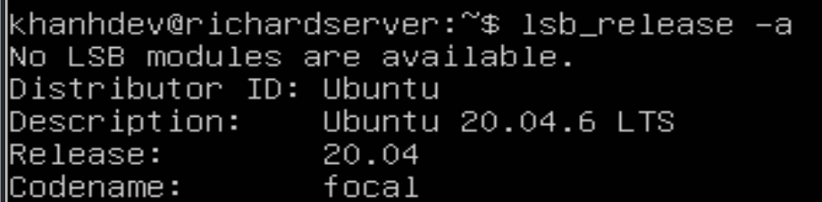

- Bước 2: cập nhật danh sách gói phần mềm:

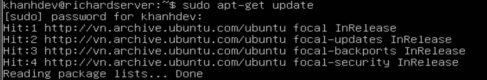

- Bước 3: nâng cấp phần mềm và cài đặt các công cụ cơ bản:

  - Nâng cấp bằng lệnh `sudo apt-get upgrade -y`


### 1.1. Tối ưu hóa tài nguyên: Cấu hình RAM ảo

- Bước 1: kiểm tra hệ thống bằng `free -h`

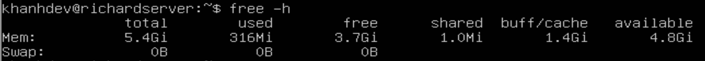

- Bước 2: tạo 1 file trống dùng lượng 4GB để làm Swap: `sudo fallocate -l 4G /swapfile`
- Bước 3: Cấu hình thành công:

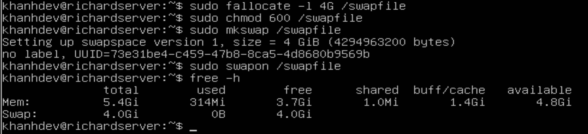


### 2. Các bước cài đặt Confluent qua APT repository

- Việc cài đặt thông qua APT repository là phương pháp tối ưu nhất trên Ubuntu. Nó không chỉ tự động giải quyết các dependecies mà còn đăng kí sẵn các dịch vụ vào hệ thống quản lý `systemd`, giúp chúng ta dễ dàng khởi động, tắt và xem log sau này.

- Bước 1: Tạo thư mục để chứa Confluent public key được sử dụng để kí trong Confluent packages trong APT repository:

> `sudo mkdir -p /etc/apt/keyrings`

- Bước 2: Tải và cài đặt Conflfuent public key

> `wget -qO - https://packages.confluent.io/deb/8.1/archive.key | gpg \
--dearmor | sudo tee /etc/apt/keyrings/confluent.gpg > /dev/null`

- Bước 3: thêm Confluent repository vào /etc/apt/sources.list.d tham chiếu tới địa chỉ của khóa kí

```bash
CP_DIST=$(lsb_release -cs)
echo "Types: deb
URIs: https://packages.confluent.io/deb/8.1
Suites: stable
Components: main
Architectures: $(dpkg --print-architecture)
Signed-by: /etc/apt/keyrings/confluent.gpg
Types: deb
URIs: https://packages.confluent.io/clients/deb/
Suites: ${CP_DIST}
Components: main
Architectures: $(dpkg --print-architecture)
Signed-By: /etc/apt/keyrings/confluent.gpg" | sudo tee /etc/apt/sources.list.d/confluent-platform.sources > /dev/null
```


### 3. Bắt đầu Confluent platform

> Nên khởi động KRaft controller trước, rồi đến Kafka brokers, rồi đến Schema Registry trước khi khởi động các thành phần khác (KRaft -> broker -> Schema registry -> ...)

#### 3.1. Trước khi bắt đầu Kafka, thì chúng ta sử dụng tool `kafka-storage` với lệnh `random-uuid` để tạo ra 1 cluster ID cho mỗi cluster mới:

```bash
bin/kafka-storage random-uuid
bin/kafka-storage format -t q1Sh-9_ISia_zwGINzRvyQ -c etc/kafka/controller.properties
```

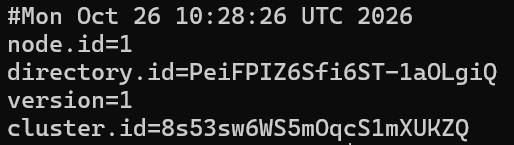

- `node.id`: Đóng vai trò là id của server(controller/broker) hiện tại. Trong một cụm Kafka có nhiều máy, hệ thống dựa vào ID này đê rbieets máy nào đang hoạt động, máy nào bị sập, và điều phối chính xác dữ liệu về cho máy đó xử lý. Hai máy trong cùng một mạng lưới không được trùng **node.id**
- `directory.id`: Dùng để quản lý vòng đời của dữ liệu ở cấp độ ổ đĩa lưu trữ. Nhờ uuid này, nếu đổi tên thư mục gốc hoặc dời toàn bộ dữ liệu sang một phân vùng ổ cứng khác, Kafka vẫn nhận diện được chính xác khối dữ liệu cũ dựa vào ID bên trong file.
- `verison=1`: version=1 địa diện cho chuẩn Kraft mới thày vì Zookeeper như trước đây (version=0)
- `cluster.id`: là mã định danh cụm. Bất kì server nào muốn tham gia vào hệ thống đồng bộ dứ liệu với nhau đều bắt buộc phải mang chung một mã **cluster.id**. Điều này giúp ngăn chặn server lạ kết nối vào hệ thống.


#### 3.2. Bắt đầu kafka

- **Confluent platform**:

```bash
sudo systemctl start confluent-server
```

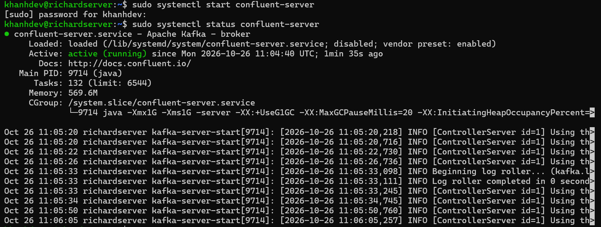

  - sau khi start ta kiểm tra status của confluent-server, nếu thấy trạng thái là *active (running)* là server chạy thành công


- **Confluent schema registry**:

```bash
sudo systemctl start confluent-schema-registry
```

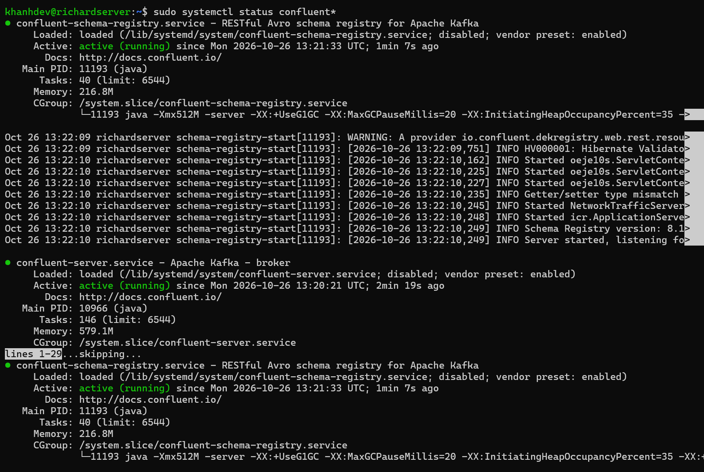

  - hiện tại confluent-schema-registry đã được active.

### 4. Cẩu hình `server.properties` (Listener) để máy host có thể kết nối vào máy ảo

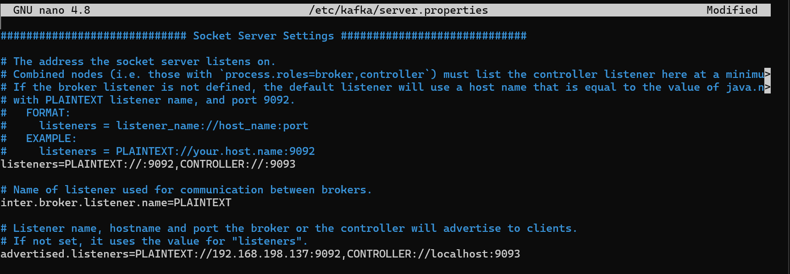

- Advertised.listener phải dùng ip thực vì đây là cổng giao tiếp dành cho luồng dữ liệu. Các ứng dụng từ bên ngoài cần kết nối trực tiếp vào cổng này để Produce và Consume message. Vì ứng dụng bên ngoài là luồng truy cập ngoài máy ảo, nên kafka bắt buộc phải gán địa chỉ IP của Vm dể client có thể tìm tới

## Phần 2: Test Kafka plugin for jetbrains IDEs

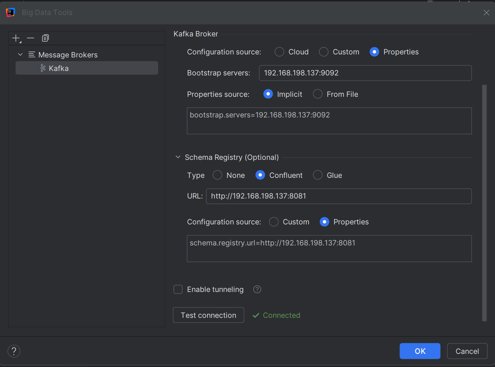

> Kết nối thành công tới Confluent trong VM


- Tạo thành công topic đầu tiên: 

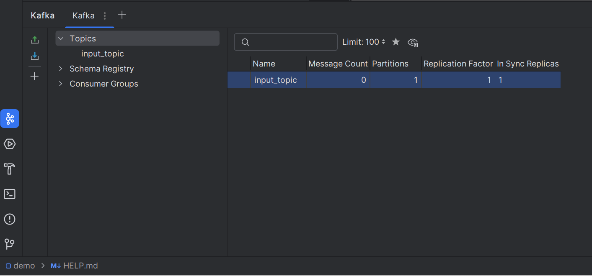

-> Kiểm tra trên server đã chứa topic mới tạo

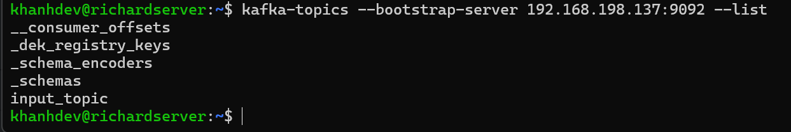

- produce to a topic:

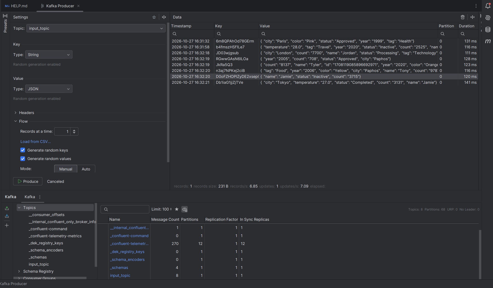


- consume to a topic: 

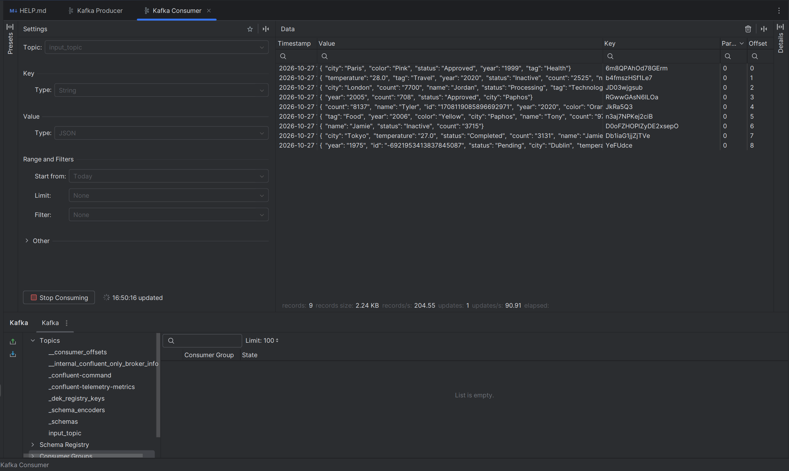


## Phần 3: Confluent(advanced demo):

- Mục tiêu: sử dụng các công cụ giá trị nhất của Confluent

### 1. Quản lý cấu trúc dữ liệu với Schema Registry:

- Tạo 1 schema định dạng JSON hoặc Arvo. Cố tình gửi 1 bản tin sai cấu trúc -> Schema Registry chặn dữ liệu rác để bảo vệ hệ thống

- Bước 1: tạo schema với 2 field id(string), temparature(float):

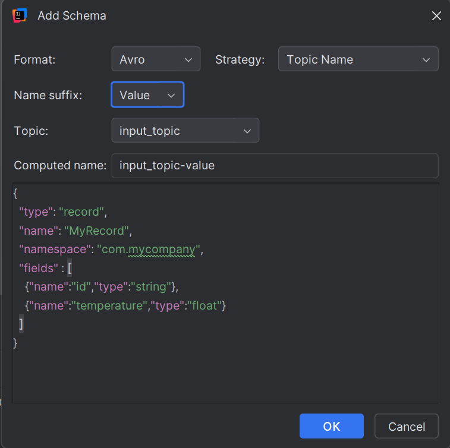

- Bước 2: gửi 1 message sai định dạng

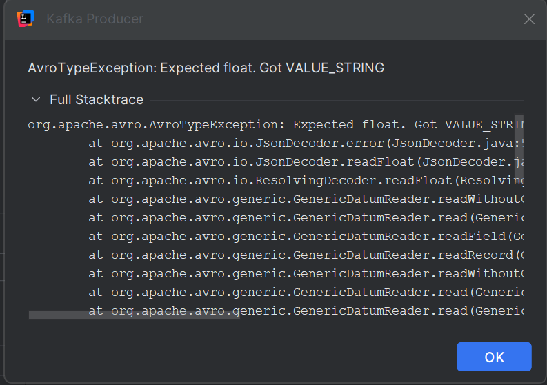

- Bước 3: gửi 1 message chuẩn

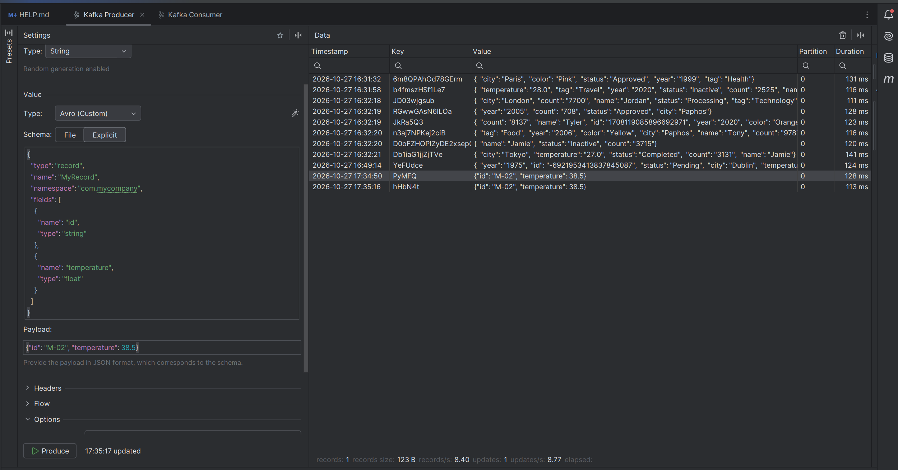

### 2. Tích hợp không cần code với Kafka Connect

- Demo cài đặt 1 file stream source connector để tự động đọc dữ liệu từ 1 file .txt/.csv trên máy ảo rồi đẩy vào Topic

- Bước 1: Cài dặt Connect từ Confluent hub

```bash
sudo confluent-hub install --no-prompt confluentinc/kafka-connect-datagen:latest
```

- Bước 2: khởi tạo Topic (tạo 1 topic `orders-topic`)

```bash
kafka-topics --create --topic orders-topic --bootstrap-server localhost:9092 --partitions 1
```

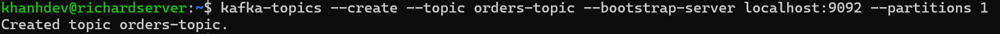

- Bước 3: Tạo file cấu hình cho Connector (yêu cầu Datagen sinh ra các đơn hàng giả lập 1 đơn/s)

```bash
cat <<EOF > ~/datagen-orders.properties
name=datagen-orders-source
connector.class=io.confluent.kafka.connect.datagen.DatagenConnector
kafka.topic=orders-topic
quickstart=orders
max.interval=1000
tasks.max=1
EOF

```

- Bước 4: Chạy Kafka Connect

```bash
sudo connect-standalone /etc/kafka/connect-standalone.properties ~/datagen-orders.properties

```

> Dữ liệu do Datagen tạo ra được bơm liên tục

- Bước 5: Kiểm chứng luồng dữ liệu với Consumer

```bash
kafka-console-consumer --topic orders-topic --bootstrap-server localhost:9092

```

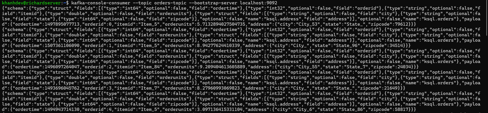


### 3. Ứng dụng KsqlDB 

- Ứng dụng tiếp nối phần Kafka connect ở phía trước, ta sẽ tiếp tục lọc dữ liệu trực tiếp thông qua KsqlDB

- Bước 1: Khởi động dịch vụ KsqlDB

```bash
sudo systemctl start confluent-ksqldb

```

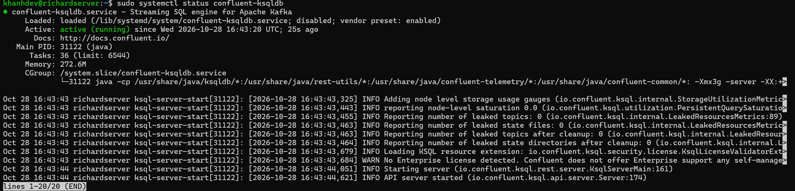

- Bước 2: TRuy cập vào KsqlDB CLI:

```bash
sudo ksql http://localhost:8088
```

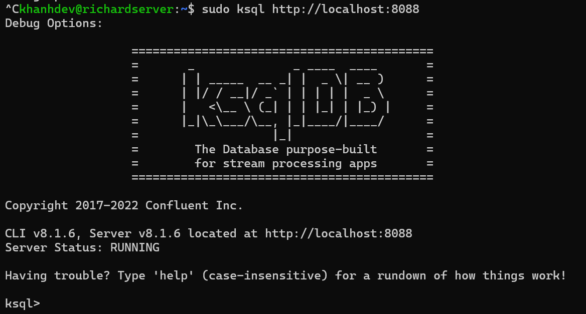

- Bước 3: Đọc thử dữ liệu thô từ topic `orders-topic`:

```bash
PRINT 'orders-topic' FROM BEGINNING LIMIT 3;

```

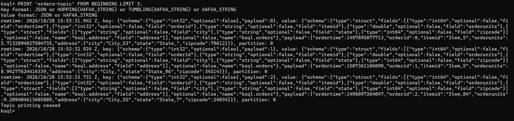

- Bước 4: Tạo stream:


```bash
CREATE STREAM orders_stream(
  payload STRUCT<
    ordertime BIGINT,
    orderid INT,
    itemid VARCHAR,
    orderunits DOUBLE
  >
) WITH (
  KAFKA_TOPIC='orders-topic',
  VALUE_FORMAT='JSON'
);

```

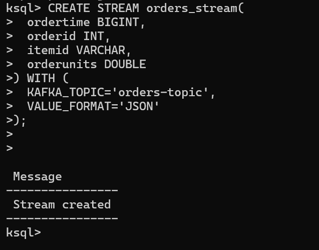

- Bước 5: Viết SQL truy vấn realtime

```bash
SELECT payload->orderid, payload->itemid, payload->orderunits 
FROM orders_stream 
WHERE payload->orderunits > 5.0 
EMIT CHANGES;

```

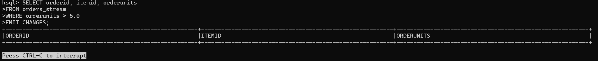


- Bước 6: đổ data từ Datagen và quan sát trong stream

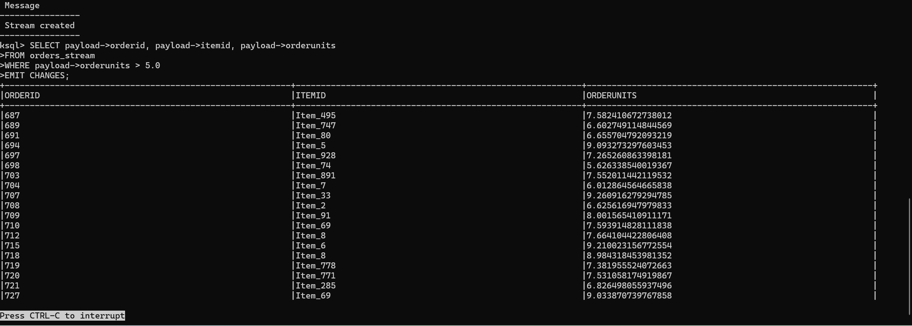

> Đã lọc được data realtime

## Phần 4: khắc phục sự cố

- Mục tiêu: ghi chép lại những lỗi đã gặp trong quá trình lab 

### 1. Lỗi `InvalidReplicationFactorException` trên Kafka Single-node ([Phần 2](#phần-2-test-kafka-plugin-for-jetbrains-ides))

- Khi test kết nối từ máy Host vào VM, `Confluent-server` bị sập ngay sau khi khởi động trên môi trường VM 1 node, log ném ra exception `InvalidReplicationFactorException`
- Nguyên nhân: 
  - Confluent platform được thiết kế mặc định cho môi trường Cluster. Các process ngầm của bản Enterprise (quản lý license, telemetry, metadata) sẽ tự động sinh ra các topic nội bộ như (_confluent-command, __consumer_offsets).
  - Các topic nội bộ này được cấu hình cứng phải có **3 bản sao** (replication factor = 3) để đảm bảo tính HA
  - Do lab chỉ có duy nhất 1 Broker, Kafka không thể phân bổ đủ 3 bản sao sang 3 máy chủ khác nhau, dẫn đến vi phạm quy tắc trên và dịch vụ tự động sập
- Giải quyết:
  - Bỏ qua yêu cầu phân tán dữ liệu bằng cách ép toàn bộ replication.factor và các thành phần cuar Confluent xuống mức thấp nhất
  - Bổ sung cấu hình này ở cuối file `/etc/kafka/server.properties`:

```bash
# Ép hệ số nhân bản của Topic quản lý vị trí đọc (offsets) và giao dịch xuống 1
offsets.topic.replication.factor=1
transaction.state.log.replication.factor=1
transaction.state.log.min.isr=1

# Ép hệ số nhân bản của các Topic nội bộ thuộc Confluent Enterprise xuống 1
confluent.license.topic.replication.factor=1
confluent.metadata.topic.replication.factor=1
confluent.security.event.logger.exporter.kafka.topic.replicas=1
confluent.telemetry.metrics.export.topic.replicas=1

```


### 2. Lỗi khi lab với KsqlDB ([Mục 3.3](#3-ứng-dụng-ksqldb))

- Khi sử dụng Datagen, dữ liệu được gen ra trong field `payload` với dạng như này `value: {"schema":{...}, "payload":{"ordertime":1497895077713, "orderid":0, "orderunits":5.71...}}`.
- Sau đó khi tạo 1 stream trong Ksql, thì em viết các field con của đơn hàng(orderid, orderunits,...) ngay lớp ngoài cùng của JSON nên chưa thể lọc ra được nên Stream cũ 

```bash
CREATE STREAM orders_stream(
  ordertime BIGINT,
  orderid INT,
  itemid VARCHAR,
  orderunits DOUBLE
) WITH (
  KAFKA_TOPIC='orders-topic',
  VALUE_FORMAT='JSON'
);

```

-> đã được đổi lại thành bọc trong field `payload`


```bash
CREATE STREAM orders_stream(
  payload STRUCT<
    ordertime BIGINT,
    orderid INT,
    itemid VARCHAR,
    orderunits DOUBLE
  >
) WITH (
  KAFKA_TOPIC='orders-topic',
  VALUE_FORMAT='JSON'
);

```

- Đồng thời thay đổi câu query, các thuộc tính trong đơn hàng sẽ được convert thành dạng `payload->(field)`